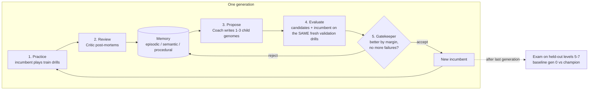

# SPARKLETEAM: a dishwasher-loading team that gets better with experience

SPARKLETEAM (the crew: `crew`, package `@spotless/crew`) is a team of agents on
[Crusoe Managed Inference](https://crusoe.ai) that plays Spotless, the dishwasher-loading game of
DishwasherBench, and improves itself between runs. After every generation it reviews what worked
item by item, rewrites its own prompts, playbook, tool policy and team structure, and keeps a
change only if it scores measurably better on fresh tasks. The proof is a before-and-after exam on
levels the team never trained on.

Built for the Crusoe x Cerebral Valley Recursive Agents Hackathon. Paper: *Towards Recursive Self
Home Improvement*.

## Contents

- [Why this domain](#why-this-domain)
- [The team](#the-team)
- [The loop](#the-loop)
- [The genome](#the-genome)
- [Memory](#memory)
- [The Gatekeeper](#the-gatekeeper)
- [The exam](#the-exam)
- [Studio](#studio)
- [Crusoe usage](#crusoe-usage)
- [How to run](#how-to-run)
- [Results](#results)
- [Where things are](#where-things-are)

## Why this domain

Self-improvement needs a reward that cannot be argued with. Most agent tasks are scored by an LLM
judge, which can be flattered, drifts between versions and rewards confident prose.

Spotless is scored by physics. An LLM loads a 3D model of a real Bosch SMV4HAX40G through 13 MCP
tools (`place`, `remove`, `set_rack`, `list_slots`, `check_load`, `start_cycle` and the rest),
with rigid-body physics on exact shapes. A deterministic GPU wash simulation (jets from the
measured nozzle positions, droplets, run-off, soil and detergent chemistry) then decides which
items come out clean, and the team earns points for each one.

- **Objective.** The score is points earned over points available. No judge, no rubric.
- **Deterministic.** The same load always settles the same way and always washes to the same
  score. The only noise in an evaluation is the model's own sampling.
- **Unfakeable.** The team cannot talk its way to a higher score. A bowl mouth-up under a dead
  spot of the spray arm stays dirty however the agent describes it.
- **Rich enough to learn.** Item kind, soil, rack, stance and neighbours all matter, and every
  episode returns item-level outcomes (clean, holds water, residue) to learn from.

## The team

Every model role runs on an NVIDIA Nemotron model served by Crusoe.

| Role | Runs on | Job |
| --- | --- | --- |
| Loader | `nvidia/NVIDIA-Nemotron-3.5-Super-VL` (thinking off) | Plays the game: MCP tools plus rendered images of the racks. |
| Planner | `nvidia/NVIDIA-Nemotron-3.5-Super-VL` | Writes a loading plan from the level card and the memory brief. |
| Critic | `nvidia/Nemotron-3-Nano-Omni-Reasoning-30B-A3B` | Item-by-item post-mortem of each episode, with pictures of the final load; emits lessons. |
| Coach | `nvidia/NVIDIA-Nemotron-3-Super-120B-A12B` | Proposes typed edits to the team's own genome. |
| Librarian | `nvidia/NVIDIA-Nemotron-3-Nano-30B-A3B` + memory code | Memory code stores episodes, merges lessons and derives placement statistics; the model writes the brief. |
| Gatekeeper | deterministic code | Statistics: accepts or rejects each candidate genome. |

The judge is code on purpose: the Gatekeeper's statistics and the physics decide what is kept, so
the team can change how it plays, never how it is graded.

## The loop



Inside one episode:

```
 level card + memory brief
          |
       Planner ---- plan ----> Loader <---- 13 MCP tools + images ----> Spotless game server
                                 |                                         (Jolt physics)
                           start_cycle (after enforced check_load)
                                 |
                                 v
                    deterministic GPU wash  -->  item outcomes, points / points available
                                 |
                              Critic  -->  lessons  -->  Librarian (memory)
```

## The genome

The genome is everything the team may rewrite about itself. It is immutable and versioned: a
change never edits a genome in place, it produces a child with a `parentId`, a generation number
and the Coach's rationale, so the full lineage is kept and diffable.

| Part | Contents |
| --- | --- |
| Prompts | Planner system prompt, loader preamble, Critic system prompt. |
| Playbook | Loading rules, each with tags (item kind, soil, rack) and evidence links to the lessons that support it. |
| Tool policy | Tools denied to the loader; enforced preflight (no `start_cycle` before a `check_load` the loader has read). |
| Team structure | Planner on/off, memory brief on/off, number of lessons in the brief. |
| Loader settings | Reasoning effort, images on/off, turn limit. |

The Coach can only change it through typed edits: `add_rule`, `edit_rule`, `remove_rule`,
`set_prompt`, `set_team`, `set_loader`. Each proposal carries a title and a falsifiable
hypothesis, and the Coach is told which past ideas were rejected so it does not retry them.

## Memory

Three layers, persisted under `.crew/`, so the team's history accumulates across runs.

- **Episodic.** Every episode, item by item: kind, soils, rack, stance, clean, holds water,
  residue, plus turns, tokens and how the loader stopped.
- **Semantic.** Lessons with support and contradiction counts and a Bayesian confidence,
  deduplicated on merge. Two sources: lessons the Critic writes, and *observed* lessons derived
  automatically from placement statistics (clean rate per item kind, rack and stance).
- **Procedural.** Every genome, every Gatekeeper decision with its per-task scores, and the
  current champion.

Exam episodes are stored apart and are never read back into memory.

## The Gatekeeper

Each candidate and the incumbent play the same fresh validation drills with the same seeds. This
is a paired comparison: because the wash is deterministic, the task difficulty cancels out and the
difference per task is the effect of the genome plus the model's sampling noise. Comparing against
a historical score instead would mix in which drills happened to be drawn.

A candidate is accepted only if:

1. its mean score share on the validation drills beats the incumbent's by at least the margin
   (0.03 mean score share), and
2. it has no more failed episodes (provider errors, turn or token budget exhaustion) than the
   incumbent.

Otherwise it is rejected, and the rejection (title, hypothesis, per-task deltas, reason) is
written to procedural memory, where the Coach sees it next time.

## The exam

The proof is a held-out exam.

- **Training drills** are drawn from course levels 1-4: tutorial, lunch for four, weeknight
  dinner, breakfast.
- **Exam drills** are drawn from levels 5-7: everyday family load, baking day, dinner party.

"Unseen" here means more than new seeds. The exam levels contain item kinds and soils that
training never showed: a baby bottle and teat, beakers with spouts, lunch tubs, a baking tray, a
tin, a rack, a platter, a board, burnt sugar, overnight soils. The champion has to transfer what
it learned about stance, rack and spray coverage to objects it has never handled.

The baseline genome (generation 0) and the champion play the same exam drills with the same seeds.
Everything (practice, validation and exam) runs on the fast wash tier, spread over 8 game-server
shards that wash in parallel. The reported number is the difference in mean score share.

Honest limits:

- Same machine, same physics, same wash programme. The exam tests transfer to new items, soils
  and loads, not to a different dishwasher.
- The models are stochastic. A single exam pass is one sample; where we ran repeats, we report
  each one and the spread.
- The number of validation drills per generation is small, set by time and rate limits, so a
  margin protects against accepting noise but does not make each decision certain.

## Studio

The Studio (`studio`, served at http://127.0.0.1:8790) is mission control for a run:

- **Team graph** with message packets flowing between roles as they talk.
- **Live 3D view** of the loader at work: the game page embedded in watch mode, with cosmetic
  water during the wash (spinning arms, jets, droplets, pool).
- **Loader stream**: its thoughts and tool calls as they happen.
- **Evolution chart**: the incumbent line stepping up, accepted candidates in green, rejected in
  red, and the genome lineage with diffs.
- **Memory panel**: lessons with confidence bars and a placement heatmap.
- **Exam finale**: before and after bars per task.

Any finished run can be replayed at speed with `crew serve --run <id>` and `?replay=<id>&speed=8`.

## Crusoe usage

- OpenAI-compatible Serverless Inference at `https://api.inference.crusoecloud.com/v1`.
- Prefix caching kept byte-stable: the harness never rewrites earlier turns (except folding old
  turns), so long loader episodes hit the cache.
- Client-side per-model rate limiting with jittered exponential backoff on 429 and 503.

## How to run

```sh
pnpm install
echo 'CRUSOE_API_KEY=...' >> .env

# One episode end to end: models reachable, tools work, wash scores
pnpm --filter @spotless/crew crew smoke

# Three generations of self-improvement, then the held-out exam
pnpm --filter @spotless/crew crew evolve --generations 3 --exam

# Watch it live
open http://127.0.0.1:8790

# Exam only: baseline vs current champion
pnpm --filter @spotless/crew crew exam

# Replay a finished run in the Studio
pnpm --filter @spotless/crew crew serve --run <id>
```

## Results

Final run `2026-10-17T20-49-49-evolve`, archived in `crew/runs/2026-10-17T20-49-49-evolve`
(events, every model call, episode records and transcripts, memory snapshot, `report.md`). Replay:
`pnpm --filter @spotless/crew crew serve --run 2026-10-17T20-49-49-evolve`.

| | |
| --- | --- |
| Generations | 3 (fast tier, 8 shards) |
| Candidates accepted / proposed | 2/6 (both memory-derived playbook rules) |
| Exam, baseline (gen 0) | 46.0% |
| Exam, champion (`G2-704108`) | 63.7% |
| Delta | +17.8 pp (better on 3 of 4 held-out drills) |
| Evolution wall-clock time | 22.7 min |
| Tokens | 38.3M in (32.0M cached), 0.49M out |

Per held-out exam drill (points / points available):

| Drill | Baseline | Champion | Delta |
| --- | --- | --- | --- |
| Family drill #0 | 48/59 (81%) | 42/59 (71%) | -10 pp |
| Baking drill #1 | 28/71 (39%) | 63/71 (89%) | +49 pp |
| Dinner party drill #2 | 15/77 (19%) | 32/77 (42%) | +22 pp |
| Family drill #3 | 31/71 (44%) | 38/71 (54%) | +10 pp |
| **Mean share** | **46.0%** | **63.7%** | **+17.8 pp** |

Accepted changes (the champion's playbook, G0 -> G2):

- *Avoid poor-performing bowl placement* (+0.251 mean share, 3 wins / 0 losses on validation):
  R1.1, do not place the Vitrelle cereal bowl on the upper rack mouth-down tilted 45 degrees; put
  it on the lower rack on edge or leave it out.
- *Add high-confidence placement rules for glasses and cutlery* (+0.157, 2 wins / 1 loss): R2.1,
  glasses and tumblers upper rack mouth-down; R2.2, cutlery upright in the cutlery basket.

Rejected: enabling the Planner (-0.086), two memory-brief variants (+0.021, -0.291) and the
enforced preflight check (-0.109), all below the 0.03 margin.

Top lessons in memory: tilt glasses mouth-down in the upper rack (0.69); load cutlery upright in
the cutlery basket (0.69); place items with tomato sauce on the lower rack on edge (0.65).

## Where things are

- `crew/src/contracts.ts`: the types (genome, edits, episodes, lessons, decisions, events).
- `crew/src/team`: the roles.
- `crew/src/memory`: the Librarian.
- `studio`: the visualizer.
- `docs/crew/SUBMISSION.md`: short factual project summary.
